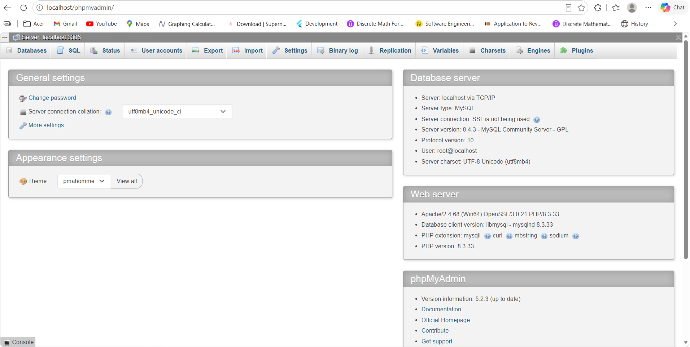

# REST API mini project: 📚 Perpustakaan(Flask & SQLAlchemy)
## 💻 System Requierement
     - Pyhton 3.10+(make sure to click the "Add Python to PATH" button befor download)
     - MySQL Database Server(you can use XAMPP or Laragon, but i use Laragon)
     - Postman(for API testing)
## 🗄  Database Configuration
1. Start Laragon. After installing Laragon, open the Laragon Control Panel and click Start All to start the required services.
2. Open phpMyAdmin. In the Laragon Control Panel, click Menu, select MySQL, and then click phpMyAdmin.
3. Log in to phpMyAdmin. Your browser will open the phpMyAdmin login page. By default, Laragon uses the following credentials:
    - Username: root
    - Password: Leave this field empty.
4. Enter root as the username, leave the password field blank, and click Log in.
5. When you finally login to the phpMyAdmin page, you will see this page:
6. 
   
7. Open the Databases page. Look for the Databases tab at the top of the page and click it.

    
    
    
    
## 🚀 To run the application
## ⚙️ API testing
