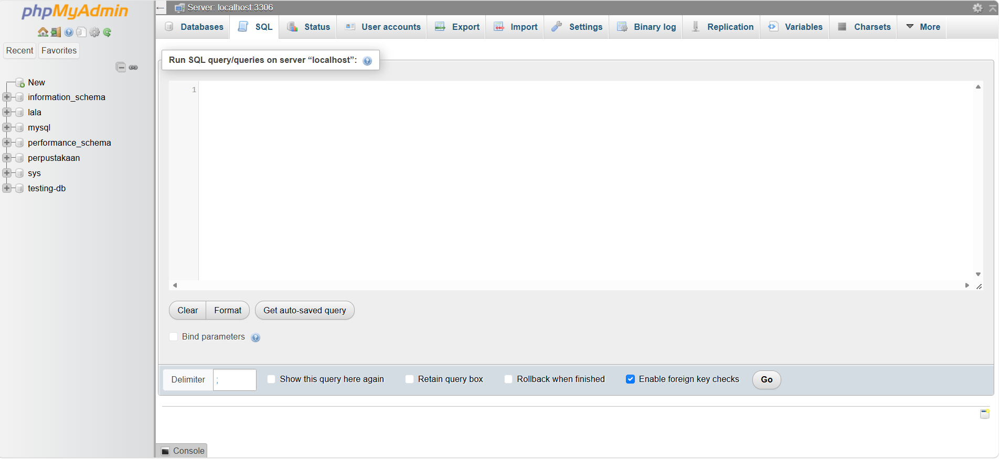

# REST API mini project: 📚 Perpustakaan(Flask & SQLAlchemy)
## 💻 System Requierement
     - Pyhton 3.10+(make sure to click the "Add Python to PATH" button befor download)
     - MySQL Database Server(you can use XAMPP or Laragon, but i use Laragon)
     - Postman(for API testing)
## 🗄  Database Configuration
1. Start Laragon. After installing Laragon, open the Laragon Control Panel and click Start All to start the required services.
2. Open phpMyAdmin. In the Laragon Control Panel, click Menu, select MySQL, and then click phpMyAdmin.
3. Log in to phpMyAdmin. Your browser will open the phpMyAdmin login page. By default, Laragon uses the following credentials:
    - Username: root
    - Password: Leave this field empty.
4. Enter root as the username, leave the password field blank, and click Log in.
5. When you finally login to the phpMyAdmin page, you will see this page:
   
7. In the navigation bar above, pick the "SQL" button, and it will lead you to the SQL Query Editor

    
    
    
    
    
8.In the the SQL Query Editor Create the database name "perpustakaan" with the following Query:

     ```
     CREATE DATABASE perpustakaan;
     ```
     
9. Determine configuration in the "main.py":
   Open main.py and find the database connection configuration. Set it to the following URL:
        ```
        mysql+pymysql://root:@localhost:3306/perpustakaan
        ```
   | Component       | Value           | Description                                                                                                                                    |
   |-----------------|-----------------|------------------------------------------------------------------------------------------------------------------------------------------------|
   | Database Driver | `mysql+pymysql` | Specifies MySQL as the database and PyMySQL as the Python driver.                                                                              |
   | Username        | `root`          | The MySQL username used to connect to the database.                                                                                            |
   | Password        | Empty           | No password is configured for this setup.                                                                                                      |
   | Host            | `localhost`     | Connects to MySQL running on your own computer. If MySQL runs on another server, replace `localhost` with the server's IP address or hostname. |
   | Port            | `3306`          | The default MySQL port. Change it if your MySQL server uses a different port.                                                                  |
   | Database Name   | `perpustakaan`  | The name of the database created in Step 8.                                                                                                    |
   
   **Important**: Make sure the username, password, host, port, and database name match your MySQL configuration. If you use a password, add it after root: in the connection URL.
   
   **Note**: This configuration assumes MySQL is running locally and the root account has no password. For production environments, use a dedicated database user with a strong password instead of the root account.
    
## 🚀 To run the application
## ⚙️ API testing
